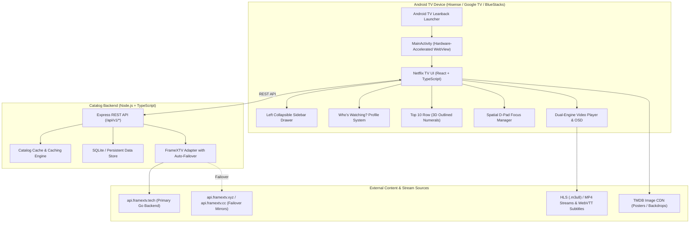

# Netflix Android TV — Production-Quality Streaming App

**Netflix Android TV** is a television-native streaming application replicating the official Netflix Android TV interface 100%, built with React, TypeScript, a resilient Node.js catalog backend (integrating FrameXTV), and an Android TV Leanback native shell.

```
          _   _ _____ _____ _____ _     _____ _   _ 
         | \ | | ____|_   _|  ___| |   |_   _| \ | |
         |  \| |  _|   | | | |_  | |     | | |  \| |
         | |\  | |___  | | |  _| | |___ _| |_| |\  |
         |_| \_|_____| |_| |_|   |_____|_____|_| \_|
         
     =================================================
     [ Search ] [ Home ] [ TV Shows ] [ Movies ] [ My List ]
```

---

## Architecture Overview



---

## Key Features

1. **Exact Netflix Android TV Experience**:
   - **Left Collapsible Sidebar Drawer**: Authentic expandable sidebar with navigation items (*Search*, *Home*, *Series*, *Films*, *New & Popular*, *My List*, *Exit Netflix*) and smooth width transitions.
   - **"Who's Watching?" Profile Selector**: Authentic TV profile onboarding screen with 4 colorful avatars (*Kyasa*, *Guest*, *Kids*, *Family*).
   - **Top 10 in TV Shows Today**: Distinctive Netflix Top 10 row featuring 3D cut-out rank numerals (1–10) positioned behind vertical posters.
   - **Dynamic Hero Spotlight**: Netflix Red "TOP 10" badge, "98% Match", certification badges (`TV-MA` / `PG-13`), resolution badges (`4K Ultra HD`, `5.1`), high-contrast synopsis, white pill Play button, and dark translucent More Info button.
   - **Title Details Screen**: Dedicated view with backdrop scrim, match percentage, release year, seasons, episode tabs, episode preview stills, and full cast rosters.

2. **Television D-Pad Spatial Navigation**:
   - Custom `FocusContext` providing directional 2D Euclidean calculations for ArrowUp, ArrowDown, ArrowLeft, and ArrowRight.
   - Netflix-style white outline focus ring, card scale enlargement (`1.08x`), and smooth auto-scrolling into view.
   - On-screen TV grid keyboard (A-Z, 0-9, Space, Backspace, Clear) for remote typing.

3. **Dual-Engine Video Player**:
   - **Direct Stream Engine**: Native HTML5 Video + HLS.js with Netflix TV OSD (timeline seekbar, play/pause, rewind/fast-forward 10s, audio/subtitle selectors, quality info).
   - **FrameXTV PostMessage Embed Engine**: Secure iframe player with PostMessage SDK integration (`play`, `pause`, `seekBy`, `setVolume`, `mute`, and `frameXTV:timeupdate` telemetry).
   - Remote Key Mappings:
     - `ArrowLeft` / `ArrowRight`: Seek backward/forward 10 seconds.
     - `Enter` / `OK`: Toggle Play/Pause.
     - `ArrowUp` / `ArrowDown`: Show/hide playback OSD.
     - `Back` / `Escape`: Exit player, pause audio, and save viewing progress.

4. **FrameXTV Content Integration**:
   - Multi-host failover: `api.framextv.tech` -> `api.framextv.xyz` -> `api.framextv.cc` -> `api.framextv.pro`.
   - Verified catalog endpoints (`/api/home`, `/api/details`, `/api/season`, `/api/search`).
   - Built-in offline fallback fixtures for 100% resilience.

5. **Android TV Native Packaging**:
   - Android TV Leanback launcher intent filter (`android.intent.category.LEANBACK_LAUNCHER`).
   - Fixed landscape orientation (`screenOrientation="landscape"`).
   - Official Netflix TV banner (320x180) and launcher icon with red "N" ribbon.
   - `WebViewAssetLoader` with native proxy request interceptor in `MainActivity.kt` ensuring zero CORS or mixed-content errors.
   - Automatic audio and resource cleanup on `onPause()` / `onDestroy()`.

---

## Directory Structure

```
NETFLIX/
├── backend/                  # Node.js + TypeScript REST service
│   ├── src/
│   │   ├── controllers/      # Catalog, Details, Playback, Watchlist, Progress
│   │   ├── db/               # Persistent database storage (profiles, watchlist, progress)
│   │   ├── providers/        # FrameXTV adapter & mock catalog fallback
│   │   ├── routes/           # Express routes (/api/v1/...)
│   │   └── index.ts          # Server entrypoint
│   └── tests/                # Automated API & integration tests (Jest)
│
├── frontend/                 # React + TypeScript TV Application
│   ├── src/
│   │   ├── components/
│   │   │   ├── common/       # NetflixSidebar, Badges, Navigation
│   │   │   ├── profile/      # ProfileSelector ("Who's Watching?")
│   │   │   ├── details/      # ContentDetails, SeasonSelector, EpisodeCard
│   │   │   ├── focus/        # Spatial D-Pad Focus Engine (FocusContext)
│   │   │   ├── home/         # HeroBanner, ContentRail, MediaCard, Top10Card
│   │   │   ├── player/       # Dual-Engine Video Player & Netflix OSD
│   │   │   ├── search/       # TVKeyboard, SearchBar, ResultsGrid
│   │   │   └── watchlist/    # User saved titles
│   │   └── App.tsx           # Screen routing & remote handling
│   └── dist/                 # Production web bundle
│
└── android/                  # Android TV Native Project
    └── app/
        ├── src/main/
        │   ├── assets/       # Embedded Netflix TV Web Bundle
        │   ├── java/         # MainActivity with native proxy & TV KeyEvent bridge
        │   └── res/          # Leanback TV banner & Netflix launcher icons
        └── build.gradle
```

---

## Quick Start & Verification

### 1. Run the Backend Service
```powershell
cd backend
npm install
npm test            # Run integration tests (7/7 passed)
npm start           # Starts on http://0.0.0.0:8080
```

### 2. Run the Frontend (Web / TV Browser)
```powershell
cd frontend
npm install
npm test            # Run Vitest tests (3/3 passed)
npm run dev         # Starts on http://localhost:5173
```

### 3. Build & Install Android TV APK
```powershell
cd android
./gradlew assembleDebug
# Install to connected Android TV or emulator:
adb install -r app/build/outputs/apk/debug/app-debug.apk
# Launch Netflix:
adb shell monkey -p com.cinewave.tv -c android.intent.category.LAUNCHER 1
```

The compiled Android TV debug APK is ready at:
`android/app/build/outputs/apk/debug/app-debug.apk` (3.86 MB)
